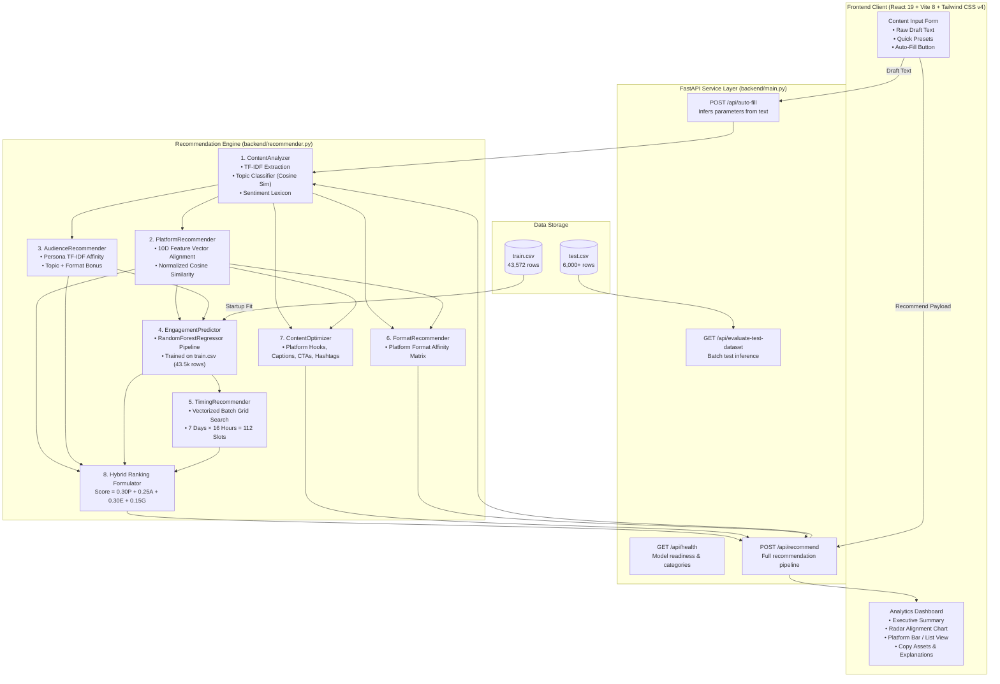

# ContentPilot: Multi-Platform Content, Audience & Timing Recommendation System

**ContentPilot** is an intelligent recommendation engine and analytics dashboard that optimizes social distribution strategy. It combines **Natural Language Processing (NLP)**, **Vector Space Similarity Matching**, and a **Supervised Random Forest Regressor** trained on 43,500+ social media engagement records to accurately recommend the optimal publishing platform, target audience persona, peak engagement window, content format, and platform-native copy.

---

## 📑 Table of Contents

- [Problem Statement & Value Proposition](#-problem-statement--value-proposition)
- [Key Features](#-key-features)
- [System Architecture](#-system-architecture)
- [End-to-End Working & Process Flow](#-end-to-end-working--process-flow)
  - [Phase 0: Server Startup & Model Training](#phase-0-server-startup--model-training)
  - [Phase 1: Input Ingestion & Sanitization](#phase-1-input-ingestion--sanitization)
  - [Phase 2: Semantic NLP & Content Intelligence](#phase-2-semantic-nlp--content-intelligence)
  - [Phase 3: Vector Space Platform Matching](#phase-3-vector-space-platform-matching)
  - [Phase 4: Audience Persona Resonance](#phase-4-audience-persona-resonance)
  - [Phase 5: Supervised ML Engagement & Peak Timing Search](#phase-5-supervised-ml-engagement--peak-timing-search)
  - [Phase 6: Format & Platform-Native Copy Generation](#phase-6-format--platform-native-copy-generation)
  - [Phase 7: Multi-Objective Hybrid Ranking & Explainability](#phase-7-multi-objective-hybrid-ranking--explainability)
  - [Phase 8: Frontend Delivery & Visual Analytics](#phase-8-frontend-delivery--visual-analytics)
- [Mathematical & Algorithmic Formulations](#-mathematical--algorithmic-formulations)
- [Frontend Design & User Interface](#-frontend-design--user-interface)
- [API Reference & OpenAPI Specifications](#-api-reference--openapi-specifications)
- [Quick Start & Local Setup](#-quick-start--local-setup)
- [Testing & Quality Assurance](#-testing--quality-assurance)
- [Dataset Schema & Engineering](#-dataset-schema--engineering)
- [Configuration & Environment Variables](#-configuration--environment-variables)
- [License & Acknowledgments](#-license--acknowledgments)

---

## 💡 Problem Statement & Value Proposition

Creators, digital marketers, and developers face common challenges when publishing content:

1. **Algorithmic Mismatch**: What succeeds on LinkedIn often falls flat on YouTube, Instagram, or X/Twitter.
2. **Suboptimal Timing**: Publishing when your specific audience is inactive drastically impairs early engagement metrics and algorithm velocity.
3. **Audience Ambiguity**: Misidentifying target demographics leads to poor retention and low conversion rates.
4. **Copy Fatigue**: Adapting a core idea across multiple formats (hooks, structured threads, video descriptions, hashtags) is time-consuming.

**ContentPilot** eliminates guesswork by transforming arbitrary drafts, post concepts, and marketing briefs into actionable distribution plans backed by quantitative metrics.

---

## ✨ Key Features

- 🧠 **Context-Aware NLP Analysis**:
  - Classifies concepts into **11 topic domains**: *AI/Machine Learning, Technology, Business, Finance, Education, Health, Travel, Food, Entertainment, Lifestyle, General*.
  - Extracts key terms via **TF-IDF** tokenization and stop-word filtering.
  - Computes sentiment valence with **negation lookback tracking** (e.g., *"not bad"*, *"never fails"*).

- 🎯 **Multi-Platform Scoring**:
  - Scores suitability across 7 major networks: **LinkedIn, YouTube, Instagram, X/Twitter, TikTok, Facebook, Threads**.
  - Dynamically synthesizes feature vectors for arbitrary custom platforms (e.g., GitHub, Medium, Substack, Reddit, Kaggle, arXiv).
  - Handles platform aliases gracefully (`x`, `twitter`, `ig`, `yt`, `li`, `fb`, `tt`).

- 👥 **Audience Persona Targeting**:
  - Evaluates semantic affinity across 10 distinct audience profiles (*Developers, Data Scientists, Business Professionals, Entrepreneurs, Researchers, Beginners, Intermediate Learners, Advanced Professionals, Tech Enthusiasts, General Audience*).
  - Preserves user-specified target audiences and dynamically prioritizes them.

- 📈 **Machine Learning Engagement Engine**:
  - `RandomForestRegressor` pipeline trained on **43,500+ records** (`train.csv`).
  - Estimates empirical engagement scores on a normalized scale (50.0–99.0) using categorical and temporal inputs.

- ⏰ **7-Day × 24-Hour Peak Timing Search**:
  - Simulates engagement across **112 weekly time slots** (Monday–Sunday, 07:00–22:00) using vectorized batch inference to discover peak posting windows.

- ✍️ **Platform-Tailored Copywriting Studio**:
  - Produces high-retention **hooks**, structured **captions**, conversion-focused **CTAs**, recommended **content lengths**, and deduplicated **hashtags**.

- 🪄 **Intelligent Auto-Fill (`/api/auto-fill`)**:
  - Evaluates raw text and infers content type, marketing goal, platform, and audience without manual form entry.

- 📊 **Modern Visual Dashboard**:
  - Built with **React 19**, **Vite 8**, and **Tailwind CSS v4**.
  - Includes **Dark Mode / Light Mode** toggle with `localStorage` persistence.
  - Interactive **Recharts Radar & Bar Charts** with view toggles.
  - One-click clipboard copying with visual toast feedback.

---

## 🏛 System Architecture



---

### Detailed Phase Breakdown

#### Phase 0: Server Startup & Model Training
When the FastAPI application initializes via its `lifespan` manager:
1. **Dataset Ingestion**: Loads [`train.csv`](file:///d:/Recommendation%20System/Mini-project/train.csv) (43,572 real social media records).
2. **Temporal Parsing**: Converts RFC 2822 timestamps (`date_posted`) into structured features: day of week (`Monday`–`Sunday`) and 24-hour integer (`0`–`23`).
3. **Log-Engagement Normalization**: Computes total engagement from likes and comments using a log-transform:
   $$E_{\text{log}} = \log(1 + \text{likes} + \text{comments})$$
   Values are scaled between the 5th and 95th percentiles into a calibrated 50.0–99.0 rating.
4. **Cross-Platform Prior Anchors**: Injects synthetic calibration anchors for platforms not heavily represented in `train.csv` (e.g., YouTube, TikTok, X/Twitter, Threads) so all channels can be evaluated consistently.
5. **Pipeline Fitting**: Fits a `scikit-learn` `Pipeline` consisting of:
   - `ColumnTransformer` with `OneHotEncoder(handle_unknown="ignore")` for categorical features (`platform`, `day`, `content_type`, `audience`, `goal`).
   - Pass-through for the numeric feature (`hour`).
   - `RandomForestRegressor(n_estimators=45, max_depth=9, min_samples_split=5)`.
6. **Readiness Guarantee**: If `train.csv` is missing or unreadable, the system automatically falls back to synthetic baseline distributions without failing.

---

#### Phase 1: Input Ingestion & Sanitization
When a request arrives at `POST /api/recommend` or `POST /api/auto-fill`:
1. **Pydantic Validation**: `RecommendRequest` validates and sanitizes incoming fields.
2. **Empty Input Fallback**: If the content text is empty, the engine injects a default fallback strategy string.
3. **Alias Normalization**: Maps informal nicknames and shorthand:
   - `"x"`, `"twitter"` $\to$ `"X/Twitter"`
   - `"yt"`, `"youtube"` $\to$ `"YouTube"`
   - `"ig"`, `"insta"`, `"instagram"` $\to$ `"Instagram"`
   - `"li"`, `"linkedin"` $\to$ `"LinkedIn"`
   - `"tt"`, `"tiktok"` $\to$ `"TikTok"`
   - `"fb"`, `"facebook"` $\to$ `"Facebook"`
4. **Inference Flags**: Records which parameters were explicitly supplied by the user versus those that need automatic inference.

---

#### Phase 2: Semantic NLP & Content Intelligence
`ContentAnalyzer` processes the draft:
1. **Text Normalization**: Strips excess whitespace, normalizes Unicode characters, and computes word count and character length.
2. **Topic Categorization**: Evaluates the text against 11 domain profiles (*AI/ML, Technology, Business, Finance, Education, Health, Travel, Food, Entertainment, Lifestyle, General*). The text is vectorized using `TfidfVectorizer` and compared against prototype profiles using Cosine Similarity.
3. **Keyword Extraction**: Identifies the highest-weight informative keywords, filtering English stop words and domain-specific terms.
4. **Rule-Based Intent Detection**:
   - Analyzes linguistic patterns (e.g., *"how to"*, *"step by step"* $\to$ **Tutorial**; *"discount"*, *"sale"*, *"% off"* $\to$ **Promotional**; *"breaking"*, *"update"* $\to$ **News**; *"my story"*, *"career advice"* $\to$ **Personal/Professional**).
   - Identifies the underlying marketing objective (*Engagement, Reach, Awareness, Leads, Conversions, Community Growth*).
5. **Negation-Aware Sentiment Analysis**: Scans tokens using a polarity dictionary. Tracks active negation windows (`"not"`, `"never"`, `"no"`, `"barely"`) to invert word sentiment when appropriate, normalizing the score by word count:
   $$\text{Sentiment Score} = \frac{\sum w_i}{\sqrt{N_{\text{words}}}}$$

---

#### Phase 3: Vector Space Platform Matching
`PlatformRecommender` projects the content into a **10-dimensional feature space**:

$$\vec{v} = \begin{bmatrix}
v_{\text{educational}}, & v_{\text{professional}}, & v_{\text{entertainment}}, & v_{\text{short\_form}}, & v_{\text{long\_form}}, \\
v_{\text{visual}}, & v_{\text{technical}}, & v_{\text{news}}, & v_{\text{promotional}}, & v_{\text{discussion}}
\end{bmatrix}^T$$

1. **Content Vector Construction**: Adjusts values along each dimension based on detected content type, topic vertical, text length, and marketing goal.
2. **Cosine Similarity Evaluation**: Computes the dot product between the normalized content vector $\vec{v}$ and platform suitability vectors $\vec{p}$:
   $$\text{Sim}(\vec{v}, \vec{p}) = \frac{\vec{v} \cdot \vec{p}}{\|\vec{v}\|_2 \|\vec{p}\|_2}$$
3. **Dynamic Unknown Platform Synthesis**: If a non-standard platform is provided (e.g., `"Substack"`, `"Medium"`, `"Kaggle"`, `"HuggingFace"`, `"GitHub"`), the system synthesizes a candidate feature vector on the fly using semantic clues from the platform's name.

---

#### Phase 4: Audience Persona Resonance
`AudienceRecommender` matches content against 10 target personas:
1. **TF-IDF Keyword Affinity**: Compares content tokens against persona interest dictionaries (up to 40 points).
2. **Topic Affinity Bonus**: Awards up to 35 points if the detected topic matches primary persona domains.
3. **Content Type Bonus**: Awards up to 25 points for format alignment.
4. **Explicit User Priority Rule**: If the user provides a custom target audience (e.g., `"Quantum Physicists"` or `"Angel Investors"`), the system prioritizes it as the #1 candidate.

---

#### Phase 5: Supervised ML Engagement & Peak Timing Search
`TimingRecommender` searches for the optimal posting slot:
1. **Temporal Candidate Grid**: Constructs a matrix of **112 candidate time slots**:
   - 7 days of the week: Monday through Sunday
   - 16 daily hours: 07:00 AM to 10:00 PM (hours 7 to 22)
2. **Vectorized Batch Inference**: Evaluates all 112 candidate rows in a single call via `predict_batch` on the Random Forest pipeline.
3. **Peak Selection**: Selects the slot with the highest predicted score:
   $$(d^*, h^*) = \arg\max_{(d, h)} \text{ML\_Predict}(\text{platform}, d, h, \text{content\_type}, \text{audience}, \text{goal})$$
4. **Human-Readable Output**: Converts the 24-hour integer into a standard 12-hour format (e.g., `18` $\to$ `"Wednesday 6:00 PM"`).

---

#### Phase 6: Format & Platform-Native Copy Generation
1. **Format Optimization**: `FormatRecommender` selects high-retention formats per platform:
   - *LinkedIn*: Carousel, Document Post, Text Post, Short Video
   - *YouTube*: Tutorial, Explainer, Short, Long-form Video
   - *Instagram*: Carousel, Reel, Static Post, Story
   - *X/Twitter*: Thread, Single Post, Poll
   - *TikTok*: Short Video, Carousel, Story
2. **Copywriting Studio**: `ContentOptimizer` generates structured marketing assets:
   - **Hook**: Platform-native hook designed to maximize feed retention.
   - **Caption**: Structured caption with bullet points, value takeaways, and readable spacing.
   - **CTA**: Clear call-to-action tailored to the marketing objective.
   - **Target Length**: Recommended character and word count guidelines.
   - **Hashtags**: Deduplicated, contextual hashtags derived from detected topics and keywords.

---

#### Phase 7: Multi-Objective Hybrid Ranking & Explainability
1. **Weighted Hybrid Aggregation**: Computes the final platform score across all four dimensions:
   $$\text{Final Score} = \left(0.30 \times S_{\text{platform}}\right) + \left(0.25 \times S_{\text{audience}}\right) + \left(0.30 \times S_{\text{engagement}}\right) + \left(0.15 \times S_{\text{goal}}\right)$$
2. **Ranking & Priority Alignment**: Platforms are sorted in descending order by final score. If a user specified a preferred platform, it is positioned at the top.
3. **Contextual Explainability**: Generates transparent, human-readable rationale:
   - *Why #1 Platform*: Details channel strengths, audience accessibility, and delivery format fit.
   - *Alternative Trade-Offs*: Explains why other platforms ranked lower (e.g., duration constraints, mismatch with educational content).
   - *Audience Alignment*: Explains how the topic connects to the target persona's interests.

---

#### Phase 8: Frontend Delivery & Visual Analytics
1. **Pydantic Serialization**: FastAPI packages the result into a typed JSON schema.
2. **Dashboard Rendering**:
   - **Executive Summary**: Highlights top platform and peak posting schedule.
   - **Recharts Radar Visualizer**: Renders a 4-axis polygon comparing Platform Fit, Audience Resonance, Timing Score, and Goal Fit.
   - **Platform View Toggle**: Allows switching between an informative **List View** and a colorful **Bar Chart View** (using brand colors for each platform).
   - **Copy Studio**: Provides one-click copy buttons for hooks, captions, CTAs, and hashtags with temporary checkmark feedback.

---

## 📐 Mathematical & Algorithmic Formulations

### 1. Hybrid Ranking Formulation
$$\text{Final Score} = 0.30 \times S_{\text{platform}} + 0.25 \times S_{\text{audience}} + 0.30 \times S_{\text{engagement}} + 0.15 \times S_{\text{goal}}$$

| Factor | Weight | Source | Description |
| :--- | :---: | :--- | :--- |
| **Platform Fit ($S_{\text{platform}}$)** | **30%** | Vector Cosine Similarity | Compatibility between content features and channel mechanics. |
| **Audience Fit ($S_{\text{audience}}$)** | **25%** | TF-IDF Persona Matching | Resonance with the top-ranked audience persona. |
| **Engagement Score ($S_{\text{engagement}}$)** | **30%** | Random Forest Regressor | Peak expected interaction score predicted by the ML model. |
| **Goal Fit ($S_{\text{goal}}$)** | **15%** | Platform-Goal Matrix | Alignment with the specific marketing objective. |

---

### 2. Log-Engagement Normalization
$$E_{\text{log}} = \log(1 + \text{likes} + \text{comments})$$

$$\text{eng\_score} = \text{clip}\left(55.0 + \frac{E_{\text{log}} - P_{0.05}}{P_{0.95} - P_{0.05}} \times 40.0, \, 50.0, \, 99.0\right)$$

---

### 3. Vector Space Cosine Similarity
$$\text{Sim}(\vec{v}, \vec{p}) = \frac{\sum_{i=1}^{10} v_i \cdot p_i}{\sqrt{\sum_{i=1}^{10} v_i^2} \cdot \sqrt{\sum_{i=1}^{10} p_i^2}}$$

---

## 🎨 Frontend Design & User Interface

The frontend is built with **React 19**, **Vite 8**, and **Tailwind CSS v4**:

1. **Top Bar & Real-Time Health Indicator**:
   - Displays API connectivity (`online`, `offline`, `connecting`) with a pulsing indicator.
   - One-click **Light/Dark theme toggle** persisted in `localStorage`.
2. **Interactive Input Form**:
   - Multi-line textarea with real-time character count, word count, and estimated reading time.
   - **4 Quick Presets**: *AI & Engineering*, *Product Launch*, *Tutorial Guide*, *Startup Growth*.
   - **"Auto-Fill with AI"** button for instant parameter inference.
   - **Advanced Drawer**: Fine-tune Content Type, Marketing Goal, Preferred Platform, and Target Audience.
3. **Executive Summary**:
   - Highlights the top recommended platform and peak posting schedule.
   - Interactive **Recharts Radar Visualizer** showing balance across Platform Fit, Audience Resonance, Engagement Rate, and Goal Alignment.
4. **Platform Distribution View**:
   - Toggle between **Ranked List** and **Bar Chart** views.
   - Platform brand colors (LinkedIn blue, YouTube red, Instagram pink, TikTok cyan, X/Twitter dark slate, GitHub green, etc.).
5. **Content Optimization Studio**:
   - High-retention hooks, structured captions, CTAs, target lengths, and hashtags.
   - One-click copy buttons with temporary checkmark feedback.
6. **Model Decision Explanations**:
   - Transparent rationale detailing why the #1 platform was chosen, why alternatives were ranked lower, and how the audience was matched.

---

## 🔌 API Reference & OpenAPI Specifications

Interactive Swagger UI documentation is available at `http://127.0.0.1:8000/docs`.

### Summary of Endpoints

| Method | Endpoint | Description | Status Code |
| :--- | :--- | :--- | :---: |
| `GET` | `/` | Root info & service metadata | `200 OK` |
| `GET` | `/api/health` | Health status, model readiness, allowed values | `200 OK` |
| `POST` | `/api/recommend` | Main intelligent recommendation endpoint | `200 OK` |
| `POST` | `/api/auto-fill` | Infers all parameters from raw content draft | `200 OK` |
| `GET` | `/api/evaluate-test-dataset` | Batch evaluation against `test.csv` samples | `200 OK` |

---

### Endpoint Details & Payloads

#### 1. `POST /api/recommend`
Generates comprehensive recommendations for a content draft.

**Request Payload:**
```json
{
  "content": "Building autonomous AI agents using LangChain and FastAPI: 5 architectural lessons we learned scaling to 100k daily workflows.",
  "content_type": "Educational",
  "goal": "Engagement",
  "preferred_platform": "LinkedIn",
  "target_audience": "Developers"
}
```
*(All fields except `content` are optional; omitted fields are automatically inferred.)*

**Response Payload (Truncated):**
```json
{
  "content_analysis": {
    "topic": "AI/Machine Learning",
    "keywords": ["langchain", "agents", "fastapi", "workflows", "scaling"],
    "sentiment": "Neutral",
    "content_type": "Educational",
    "goal": "Engagement",
    "content_length": 128
  },
  "inferred_parameters": {
    "content_type": "Educational",
    "goal": "Engagement",
    "preferred_platform": "LinkedIn",
    "target_audience": "Developers",
    "is_content_type_inferred": false,
    "is_goal_inferred": false,
    "is_platform_inferred": false,
    "is_audience_inferred": false
  },
  "platform_recommendations": [
    {
      "platform": "LinkedIn",
      "score": 93.4,
      "reason": "LinkedIn achieved the highest hybrid score (93.4) based on strong platform fit (96.2) and high resonance for Educational content."
    },
    {
      "platform": "YouTube",
      "score": 90.1,
      "reason": "YouTube demonstrates excellent format alignment for tutorial and educational walkthroughs."
    }
  ],
  "audience_recommendations": [
    {
      "audience": "Developers",
      "score": 98.0,
      "reason": "Developers has high compatibility (98.0) because their profile prioritizes AI/Machine Learning concepts presented in an engaging Educational format."
    }
  ],
  "timing_recommendation": {
    "day": "Wednesday",
    "hour": 9,
    "formatted_time": "Wednesday 9:00 AM",
    "score": 88.5,
    "reason": "The ML engagement model predicted peak interaction (88.5 score) on Wednesday at 9:00 AM for Developers on LinkedIn."
  },
  "format_recommendation": {
    "format": "Carousel",
    "score": 94.0,
    "reason": "The 'Carousel' format is optimal on LinkedIn for educational content on 'AI/Machine Learning'."
  },
  "content_optimization": {
    "hook": "5 things every AI/Machine Learning professional should know.",
    "caption": "Core Takeaways:\n1. Master the fundamentals like Langchain.\n2. Apply practical workflows for sustainable outcomes.\n3. Continuously iterate to build lasting impact in AI/Machine Learning.\n\nWhat has your experience been with this?",
    "cta": "Which point resonates most with your workflow? Drop your perspective below!",
    "suggested_length": "1,000 - 1,500 characters (approx. 150-250 words) with clear spacing",
    "hashtags": ["#AIMachineLearning", "#Langchain", "#Agents", "#Fastapi", "#Workflows", "#Educational"]
  },
  "expected_engagement": 88.5,
  "overall_factors": {
    "platform_fit": 96.2,
    "audience_fit": 98.0,
    "timing_score": 88.5,
    "goal_fit": 88.0
  },
  "explanation": [
    "Why LinkedIn only as #1: LinkedIn leads with a 93.4% match, providing free, open access and the strongest distribution to reach developers.",
    "Why it was recommended: Semantic topic mapping identified AI/Machine Learning as the core domain, aligning directly with open community sharing.",
    "Why other platforms were not chosen as #1: Alternative platforms exhibited lower format compatibility or weaker community engagement for this message.",
    "Audience alignment: 'Developers' demonstrated the highest compatibility score (98.0%) for this content strategy."
  ]
}
```

---

#### 2. `POST /api/auto-fill`
Analyzes text input to infer form parameters.

**Request Payload:**
```json
{
  "content": "Flash sale: 50% discount on summer running shoes today only"
}
```

**Response Payload:**
```json
{
  "content": "Flash sale: 50% discount on summer running shoes today only",
  "content_type": "Promotional",
  "goal": "Conversions",
  "preferred_platform": "Instagram",
  "target_audience": "General Audience",
  "topic": "Lifestyle",
  "keywords": ["flash", "sale", "discount", "running", "shoes"],
  "sentiment": "Positive"
}
```

---

#### 3. `GET /api/evaluate-test-dataset?limit=5`
Runs out-of-sample inference against rows from `test.csv`.

**Response Payload:**
```json
{
  "status": "success",
  "test_dataset_total_rows": 6000,
  "evaluated_samples_count": 5,
  "samples": [
    {
      "id": 0,
      "platform": "Instagram",
      "content_type": "Video",
      "caption_preview": "Si t’as deviné le nom du dessert écris le en commentaire...",
      "predicted_engagement_score": 83.2
    }
  ]
}
```

---

## ⚡ Quick Start & Local Setup

### System Prerequisites
- **Python**: `3.10` or higher
- **Node.js**: `18.0.0` or higher
- **npm**: `9.0.0` or higher

---

### Step 1: Clone the Repository
```bash
git clone <repository-url>
cd "Mini-project"
```

---

### Step 2: Configure & Start Backend
1. Navigate to the backend directory:
   ```bash
   cd backend
   ```

2. Create and activate a Python virtual environment:
   ```bash
   # Windows (PowerShell)
   python -m venv venv
   .\venv\Scripts\Activate.ps1

   # macOS / Linux
   python3 -m venv venv
   source venv/bin/activate
   ```

3. Install required Python packages:
   ```bash
   pip install -r requirements.txt
   ```

4. Launch the FastAPI server with Uvicorn:
   ```bash
   python main.py
   # Or directly with uvicorn:
   uvicorn main:app --host 127.0.0.1 --port 8000 --reload
   ```

   *The server loads `train.csv` and fits the engagement model on startup.*
   - API URL: `http://127.0.0.1:8000`
   - Swagger Documentation: `http://127.0.0.1:8000/docs`

---

### Step 3: Configure & Start Frontend
1. Open a new terminal window in the project root:
   ```bash
   cd frontend
   ```

2. Install Node dependencies:
   ```bash
   npm install
   ```

3. Launch the Vite development server:
   ```bash
   npm run dev
   ```

4. Open your browser and navigate to the displayed local address (typically `http://localhost:5173`).

---

## 🧪 Testing & Quality Assurance

### Running Backend Unit Tests
The project includes a comprehensive suite of unit tests in [`backend/tests/test_api.py`](file:///d:/Recommendation%20System/Mini-project/backend/tests/test_api.py) using Python's `unittest` framework and FastAPI's `TestClient`.

Run the test suite from the project root:
```bash
python -m unittest discover -s backend/tests
```

**Test Suite Coverage (11 Tests):**
- `test_root_endpoint`: Validates service availability and documentation links.
- `test_health_check_endpoint`: Verifies model training status and platform metadata.
- `test_recommendation_flow`: Verifies end-to-end recommendation generation and schema compliance.
- `test_platform_aliases`: Tests alias resolution (`x`, `twitter`, `yt`, `ig` $\to$ `X/Twitter`, `YouTube`, `Instagram`).
- `test_explicit_audience_priority`: Confirms custom user audiences retain top position.
- `test_empty_and_default_payload`: Validates graceful fallback behavior for empty requests.
- `test_auto_fill_endpoint`: Tests context inference from raw text.
- `test_sentiment_analysis`: Verifies polarity and negation handling.
- `test_unknown_platform_synthesis`: Confirms non-standard platforms are scored without error.
- `test_timing_optimization_bounds`: Validates that posting time predictions fall within valid ranges (07:00–22:00).
- `test_evaluate_test_dataset`: Tests batch evaluation on `test.csv`.

### Frontend Code Quality & Build Verification
```bash
cd frontend

# Run Oxlint
npm run lint

# Build production bundle
npm run build
```

---

## 📈 Dataset Schema & Engineering

The recommendation engine uses historical social engagement data:

### 1. `train.csv` (~43,572 rows, 5.28 MB)
Used to train the `EngagementPredictor` and extract temporal engagement distributions.

| Column | Data Type | Description |
| :--- | :--- | :--- |
| `id` | Integer | Unique post identifier |
| `platform` | String | Source platform (e.g., `instagram`) |
| `page_id` | UUID/String | Identifier of publishing creator/page |
| `date_posted` | RFC 2822 String | Timestamp of publication (e.g., `"Thu, 05 Mar 2026 16:05:55 GMT"`) |
| `recorded_at` | RFC 2822 String | Metric collection timestamp |
| `content_type` | String | Format of post (`Video`, `Image`, `Carousel`, `Post`) |
| `caption` | String | Post text, caption, and hashtags |
| `comments` | Integer / Float | Comment count |
| `likes` | Integer / Float | Like count |

### 2. `test.csv` (~6,000+ rows, 701 KB)
Used to validate the model against out-of-sample data via the `/api/evaluate-test-dataset` endpoint.

---

## ⚙️ Configuration & Environment Variables

### Frontend Environment
The frontend uses standard Vite environment variables. Create a `.env` file in `frontend/` if deploying against an external backend:

```env
# frontend/.env
VITE_API_BASE_URL=http://127.0.0.1:8000
```

If `VITE_API_BASE_URL` is omitted, `src/api.js` defaults to `http://127.0.0.1:8000`.

---

## 📜 License & Acknowledgments

This project is licensed under the **MIT License**. See the [LICENSE](LICENSE) file for details.

- **FastAPI**: Modern, high-performance web framework for Python.
- **scikit-learn**: Machine learning tools for data analysis.
- **React 19 & Vite**: Fast frontend tooling and reactive component architecture.
- **Tailwind CSS v4**: Utility-first CSS framework.
- **Lucide Icons & Recharts**: Visual assets and chart components.
